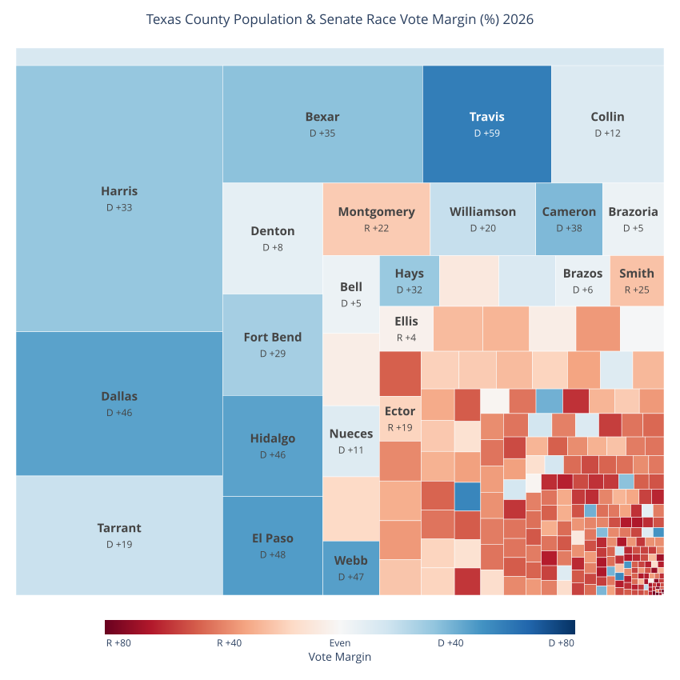
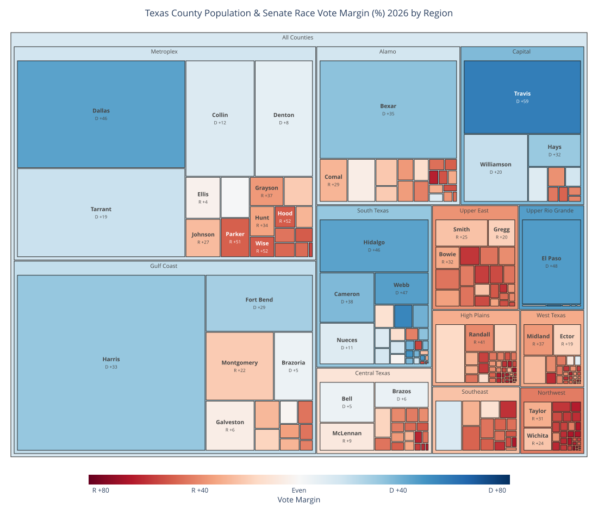

# Alternative to the Red/Blue Voter Map: US Election Analysis

An alternative to the traditional red/blue voter map. The script draws a treemap of Texas counties where each tile's **size** shows the county's population and its **color** shows the 2026 Senate race vote margin. Blue tiles are Democratic margins, red tiles are Republican margins, and white is an even result.



A second script groups the counties into the 12 official Texas Comptroller economic regions. Each region tile shows its population-weighted vote margin.



## Features

- Loads Texas county population and vote margin data from a CSV hosted online.
- Cleans the data: removes the " County" suffix from names, parses margins such as `D +33` or `R +5`, and handles `Even` or missing values.
- Builds an interactive Plotly treemap with hover tooltips and a horizontal color bar.
- Exports the chart as `plot.svg`.
- Optionally groups counties by region (All Counties → Region → County), and labels each region and the root tile with its population-weighted margin.

## Requirements

- Python 3.14 or newer
- [uv](https://docs.astral.sh/uv/) for dependency management
- Google Chrome (required by Kaleido to export images)

## Setup

1. Install the dependencies:

   ```sh
   uv sync
   ```

2. Install Chrome for Kaleido (only needed once per machine):

   ```sh
   uv run plotly_get_chrome
   ```

   If you already have Google Chrome installed, you can skip this step.

## Usage

Run the county treemap:

```sh
uv run main.py
```

This will:

1. Download and clean the county data.
2. Save the treemap to `plot.svg`.
3. Open the interactive chart in your browser.

Run the regional treemap:

```sh
uv run group_counties_by_geographical_region.py
```

This saves the chart to `plot_by_region.svg` and opens it in your browser.

In Jupyter, `fig.show()` displays the chart inline.

## Project Structure

```
.
├── main.py                                  # County treemap
├── group_counties_by_geographical_region.py # Treemap grouped by region
├── plot.svg                                 # Output of main.py
├── plot_by_region.svg                       # Output of the regional script
├── pyproject.toml                           # Project metadata and dependencies
└── uv.lock                                  # Locked dependency versions
```

## Dependencies

| Package          | Purpose                                      |
| ---------------- | -------------------------------------------- |
| `polars`         | Data loading and cleaning                    |
| `plotly[express]`| Interactive treemap (includes numpy)         |
| `kaleido`        | Exports the chart as SVG                     |
| `pyarrow`        | Listed as a dependency in `pyproject.toml`   |

## Data Source

County population and 2026 Senate race vote margins are loaded from `https://bit.ly/48jF7Zi`. The script needs an internet connection to run.

The data is from [NPR] (https://apps.npr.org/2026-election-results/texas.html?section=S), is stored in this [Gist] (https://gist.github.com/rlvaugh/193b2853afc08dc729ba53a8c9959cb0), and is accessed programmatically. It represents 99% of the total vote.

## Notes

- Population and margin figures come from the online CSV. Check that source before relying on the numbers.
- The color scale is symmetric around zero, so the largest absolute margin sets both ends of the scale.
- In the regional chart, region tiles are colored by Plotly's population-weighted average of their counties' margins.
- A county name that doesn't match any region is placed under "Other". With the current data, all 254 counties match.
