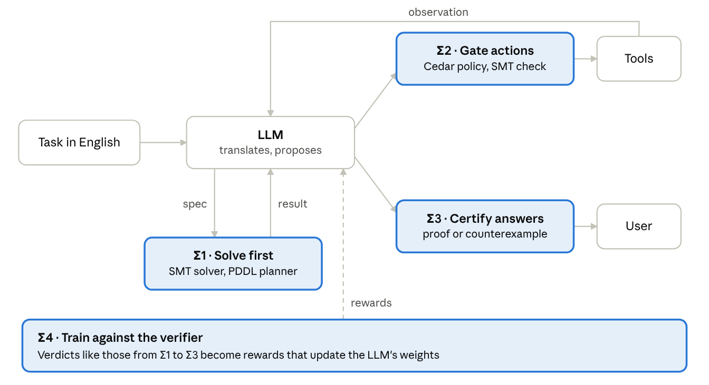

# Neurosymbolic Agents with Z3 (Python Example)

A minimal Python example demonstrating how **neurosymbolic agents** pair an LLM with a symbolic solver ([Z3](https://github.com/Z3Prover/z3)) to translate natural-language requirements into formal constraints, catch translation errors via unsatisfiable cores, and disambiguate underspecified rules.

- **Reference Article:** [Neurosymbolic Agents Explained, With a Z3 Example in Python](https://towardsdatascience.com/neurosymbolic-agents-explained-with-a-z3-example-in-python/) by Tomoharu Hayakawa (Towards Data Science)

---

## Neurosymbolic Agent Architecture



An LLM translates natural-language tasks and proposes actions, while symbolic verifiers provide formal guarantees and structured feedback across four integration points:

- **Σ1 · Solve first** *(SMT solver, PDDL planner)* — The LLM translates an English task into a formal specification (`spec`), and the solver computes a valid `result` (or reports why no solution exists).
- **Σ2 · Gate actions** *(Cedar policy, SMT check)* — Proposed tool calls are checked against policies/constraints before reaching external **Tools**, returning observations to the LLM.
- **Σ3 · Certify answers** *(proof or counterexample)* — Candidate answers are verified with a proof or counterexample before being presented to the **User**.
- **Σ4 · Train against the verifier** — Verdicts from Σ1–Σ3 serve as `rewards` to update the LLM's weights.

---

## What `main.py` Demonstrates

`main.py` models a 4-job ML pipeline scheduling problem (`ingest`, `train`, `evaluate`, `deploy`) where each job occupies a distinct 1-hour slot between `09:00` and `17:00`:

1. **Named Constraints & Unsatisfiable Cores (`unsat_core`)**
   - `schedule(spec)` registers each constraint with `s.assert_and_track(c, name)`.
   - In the initial `llm_spec`, `"deploy_gap"` is translated with a reversed inequality (`t["evaluate"] >= t["deploy"] + 2`).
   - Z3 detects the conflict and returns an unsatisfiable core identifying the conflicting constraints:
     ```python
     ['deploy_afternoon', 'deploy_gap', 'eval_before_noon']
     ```

2. **Repairing the Specification from Feedback**
   - Correcting `"deploy_gap"` to `t["deploy"] >= t["evaluate"] + 2` makes the specification satisfiable and produces a valid schedule:
     ```python
     {'ingest': 9, 'train': 10, 'evaluate': 11, 'deploy': 13}
     ```

3. **Disambiguating Competing Translations**
   - While Z3 is sound, the LLM's English-to-logic translation is not—ambiguous phrases like *"deploy in the afternoon"* can be formalized in multiple ways:
     - `reading_a`: `t["deploy"] >= 13` (afternoon begins at `13:00`)
     - `reading_b`: `t["deploy"] >= 14` (afternoon begins at `14:00`)
   - `find(reading_a != reading_b)` finds a distinguishing schedule where the two readings disagree (`deploy` at `13`), allowing the agent to ask the user for clarification instead of silently solving the wrong specification.
   - `find(reading_a, reading_b)` finds a schedule accepted by both readings (`deploy` at `14`).

---

## Project Structure

```text
.
├── 1794823749891_lihhpo.png   # Neurosymbolic agent architecture diagram
├── main.py                    # Z3 scheduling & constraint-checking example
├── pyproject.toml             # Project metadata and dependencies
├── uv.lock                    # Locked dependency versions
└── README.md
```

---

## Requirements

- Python `>= 3.14`
- `z3-solver >= 5.4.1.0`

---

## Running the Example

### Using `uv`

```bash
uv sync
uv run main.py
```

### Using a Virtual Environment (`pip`)

```bash
python -m venv .venv
# Linux / macOS:
source .venv/bin/activate
# Windows (PowerShell):
# .venv\Scripts\Activate.ps1

pip install "z3-solver>=5.4.1.0"
python main.py
```

### Expected Output

```text
['deploy_afternoon', 'deploy_gap', 'eval_before_noon']
{'ingest': 9, 'train': 10, 'evaluate': 11, 'deploy': 13}
{'ingest': 9, 'train': 10, 'evaluate': 11, 'deploy': 13}
{'ingest': 9, 'train': 10, 'evaluate': 11, 'deploy': 14}
```
